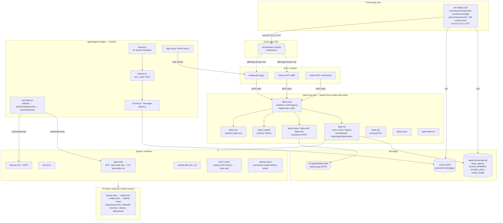
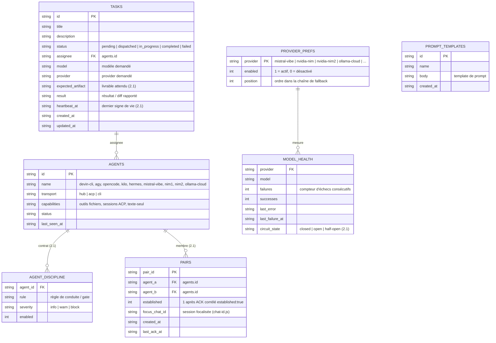
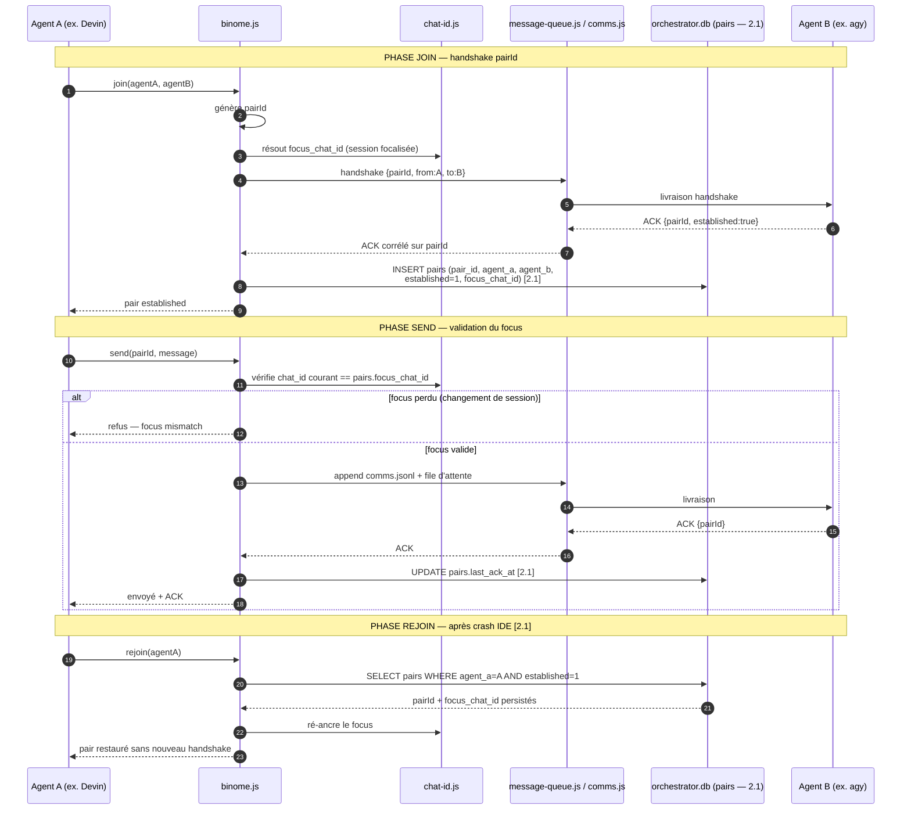
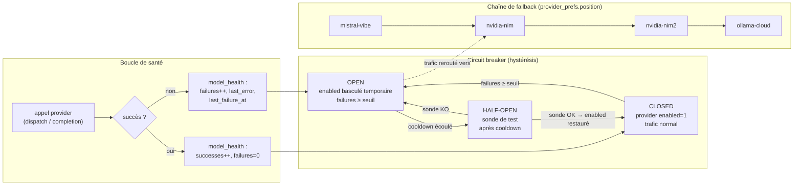
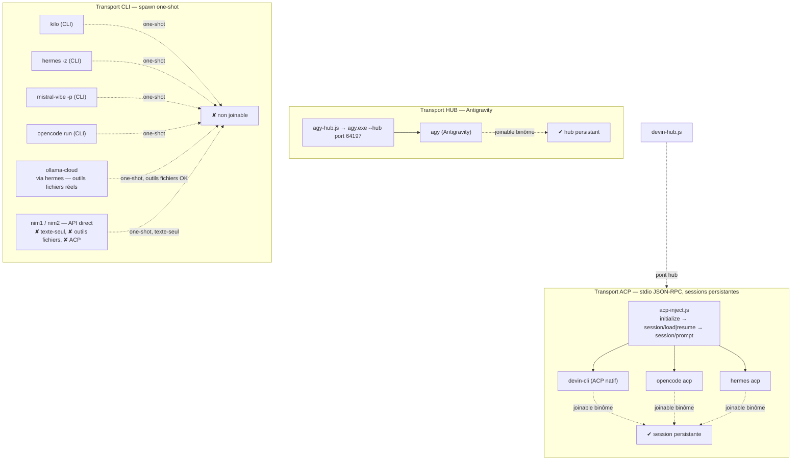
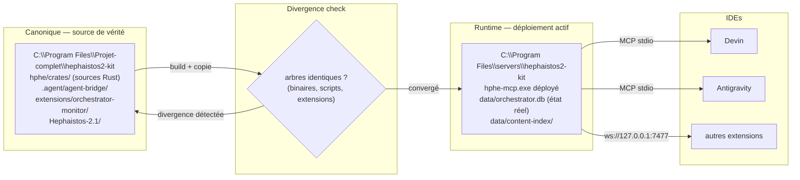

# Hephaistos2-Kit — Architecture 2.1

Document d'architecture de l'environnement multi-agents **Hephaistos2-Kit**.

- **Racine canonique (source de vérité)** : `C:\Program Files\Projet-complet\hephaistos2-kit`
- **Racine runtime (déploiement actif)** : `C:\Program Files\servers\hephaistos2-kit`
- **Base de données de l'orchestrateur** : `data/orchestrator.db` (sous la racine runtime)
- **Orchestrateur MCP** : binaire Rust unique `hphe-mcp.exe` (58 outils)

---

## 1. Vue d'ensemble

L'architecture repose sur un **binaire Rust unique** `hphe-mcp.exe` qui concentre
l'ensemble des capacités MCP : recherche NTFS, indexation de contenu, vecteurs,
graphe de connaissances, orchestration de tâches/agents/providers et ingestion.
Les IDE (Devin, Antigravity, autres) dialoguent avec lui en MCP stdio ; un pont
WebSocket (`ws-bridge`) et le répertoire `.agent/agent-bridge/` assurent la
communication temps réel et le couplage binôme entre agents.

> **Commentaire** — Les IDE parlent à `hphe-mcp.exe` en MCP stdio. Le crate
> `hphe-mcp` (fichier `tools/kit.rs`) expose la façade des 58 outils qui
> délèguent à `hphe-kit` (`orch.rs`) pour l'orchestration, à
> `hphe-index`/`hphe-mft`/`hphe-usn` pour la recherche NTFS via le named pipe
> `\\.\pipe\hphe-index`, à `hphe-content` pour la recherche de contenu Tantivy et
> à `hphe-vec` pour la recherche vectorielle. Tout l'état persistant transite par
> `data/orchestrator.db`. En parallèle, `ws-bridge` scrute la base et le journal
> `comms.jsonl` pour pousser l'état en temps réel vers les extensions IDE sur
> `ws://127.0.0.1:7477`. Le répertoire `.agent/agent-bridge/` implémente le
> protocole binôme (join/send/ACK) et l'injection ACP vers les providers
> compatibles.

---

## 2. Modèle de données

La persistance de l'orchestrateur repose sur `data/orchestrator.db`. Le schéma
actuel contient `tasks`, `agents`, `prompt_templates`, `provider_prefs` et
`model_health`. La version **2.1** ajoute `pairs` (persistance des binômes) et
`agent_discipline` (contrats de capacités/conduite par agent).

> **Commentaire** — `tasks` porte le cycle de vie d'une tâche ; `agents`
> décrit les workers connus avec leur transport (`hub`/`acp`/`cli`) et leurs
> capacités (les workers NIM sont texte-seul, sans outils fichiers ni sessions
> ACP). `provider_prefs` définit la **chaîne ordonnée** des providers via
> `enabled` + `position` — chaîne active actuelle : `mistral-vibe → nvidia-nim →
> nvidia-nim2 → ollama-cloud`, les autres entrées (`openrouter-free`,
> `kilocode`, `hermes`, `ollama`) étant désactivées. `model_health` enregistre
> les échecs par provider/modèle pour alimenter le circuit breaker. Les tables
> `pairs` et `agent_discipline` sont des ajouts **2.1** : la première rend les
> binômes re-joignables après un crash IDE, la seconde formalise les contrats
> que le dispatch doit vérifier avant affectation.

---

## 3. Séquence — `dispatch_task` actuel (état des lieux)

Le flux de dispatch actuel est **linéaire et sans garde-fous** : aucune
validation du couple model/provider, aucun check `provider_prefs.enabled`,
aucune vérification du livrable à la clôture. Trois défaillances observées en
production sont annotées : **#441** (model vide → crash), **#452** (dispatch
vers un provider désactivé), et les workers **NIM** marqués `completed` sans
avoir écrit le moindre fichier.

```mermaid
sequenceDiagram
    autonumber
    participant IDE as IDE (Devin / Antigravity)
    participant MCP as hphe-mcp.exe (tools/kit.rs)
    participant ORCH as hphe-kit orch.rs
    participant DB as orchestrator.db
    participant W as Worker (nim1, hermes, opencode...)
    participant EXT as Provider externe

    IDE->>MCP: dispatch_task(task_id, agent)
    MCP->>ORCH: routage vers orch.rs
    ORCH->>DB: UPDATE tasks SET status='dispatched', assignee=agent
    Note over ORCH,DB: ⚠ TROU : pas de validation model/provider<br/>⚠ TROU : pas de check provider_prefs.enabled

    alt Transport ACP (session persistante)
        ORCH->>W: acp-inject.js → session/prompt
    else Transport CLI (one-shot)
        ORCH->>W: spawn CLI (hermes -z, opencode run, mistral-vibe -p)
    else Transport API direct (NIM)
        ORCH->>EXT: appel HTTP texte-seul (nim1 / nim2)
    end

    W-->>ORCH: réponse texte / rapport
    ORCH->>DB: UPDATE tasks SET status='completed', result=...
    Note over ORCH,DB: ⚠ TROU : pas de completion gate<br/>aucune vérif que expected_artifact existe sur disque

    ORCH-->>IDE: retour "completed"

    rect rgb(80, 20, 20)
        Note over IDE,EXT: Défaillances observées
        Note over ORCH: #441 — tasks.model vide → crash provider<br/>(aucun fail-fast côté dispatch)
        Note over ORCH: #452 — dispatch vers provider enabled=0<br/>(provider_prefs.enabled jamais consulté)
        Note over W: NIM — texte-seul, pas d'outils fichiers :<br/>répond un diff fictif, task marquée "completed",<br/>rien n'est écrit sur disque
    end
```

> **Commentaire** — Le dispatch actuel met à jour le statut puis lance le worker
> par le transport déclaré (ACP via `acp-inject.js`, CLI one-shot, ou appel API
> direct pour NIM). Trois trous structurels : (1) le couple `model`/`provider`
> de la tâche n'est jamais validé — un `model` vide fait crasher le provider
> (#441) ; (2) `provider_prefs.enabled` n'est pas lu — un provider désactivé
> reçoit quand même du travail (#452) ; (3) la clôture se fait sur la confiance
> — un worker texte-seul comme NIM peut rapporter un diff sans l'avoir persisté,
> et la tâche passe `completed` alors que rien n'existe sur disque.

---

## 4. Séquence — architecture CIBLE 2.1

La version 2.1 introduit des **gates** à chaque transition : fail-fast sur le
contrat de tâche, vérification des capacités de l'agent, check
`provider_prefs.enabled`, heartbeat avec reaper pour les tâches zombies, et
**completion gate** vérifiant `expected_artifact` sur disque. Un outil
`verify_task` déclenche une revue QC automatique vers un reviewer.

```mermaid
sequenceDiagram
    autonumber
    participant IDE as IDE
    participant MCP as hphe-mcp.exe
    participant ORCH as orch.rs (gates 2.1)
    participant DB as orchestrator.db
    participant W as Worker
    participant REV as Reviewer (QC)
    participant RPR as Reaper (tâche de fond)

    IDE->>MCP: dispatch_task(task_id, agent, expected_artifact)
    MCP->>ORCH: dispatch

    rect rgb(20, 60, 20)
        Note over ORCH: GATE 1 — fail-fast
        ORCH->>DB: SELECT tasks.model, tasks.provider
        alt model ou provider vide/invalide
            ORCH-->>IDE: erreur immédiate (plus de crash #441)
        end
    end

    rect rgb(20, 60, 20)
        Note over ORCH: GATE 2 — capabilities
        ORCH->>DB: SELECT agents.capabilities, agent_discipline
        alt tâche exige outils fichiers ET agent texte-seul (NIM)
            ORCH-->>IDE: refus + suggestion d'agent compatible
        end
    end

    rect rgb(20, 60, 20)
        Note over ORCH: GATE 3 — provider enabled
        ORCH->>DB: SELECT provider_prefs.enabled ORDER BY position
        alt provider demandé enabled=0
            ORCH->>DB: fallback sur le prochain provider actif<br/>(résout #452)
        end
    end

    ORCH->>DB: UPDATE tasks status='dispatched'
    ORCH->>W: exécution (transport hub / acp / cli)

    loop Heartbeat
        W->>ORCH: heartbeat
        ORCH->>DB: UPDATE tasks.heartbeat_at
    end

    RPR->>DB: scan heartbeat_at expirés
    RPR->>DB: UPDATE tasks status='failed' (zombie)<br/>+ réassignation possible

    W-->>ORCH: rapport + livrable déclaré
    rect rgb(20, 60, 20)
        Note over ORCH: GATE 4 — completion gate
        ORCH->>ORCH: vérifie expected_artifact sur disque
        alt artefact absent
            ORCH->>DB: status='failed' + motif<br/>(NIM ne peut plus "compléter" sans écrire)
        end
    end

    ORCH->>DB: status='completed'
    ORCH->>REV: verify_task(task_id) — QC auto
    REV->>REV: relecture du diff / artefact
    REV->>DB: verdict QC (approve / rework)
    ORCH-->>IDE: completed + verdict QC
```

> **Commentaire** — Chaque transition passe désormais par un gate. **GATE 1**
> rejette immédiatement une tâche dont `model` ou `provider` est vide
> (fail-fast, corrige #441). **GATE 2** croise les capacités déclarées de
> l'agent avec les exigences de la tâche — une tâche demandant des outils
> fichiers ne peut plus partir sur un worker texte-seul NIM. **GATE 3**
> consulte `provider_prefs.enabled`/`position` et bascule sur le prochain
> provider actif de la chaîne (corrige #452). Pendant l'exécution, le worker
> émet des heartbeats qu'un **reaper** surveille : un heartbeat expiré fait
> passer la tâche en `failed` et la rend réassignable. À la clôture, le
> **GATE 4** impose l'existence réelle de `expected_artifact` sur disque —
> fini les `completed` sans livrable. Enfin `verify_task` envoie
> automatiquement le résultat à un reviewer QC.

---

## 5. Séquence — protocole binôme

Le binôme couple deux agents via `.agent/agent-bridge/`. Le `join` effectue un
handshake `pairId` confirmé par un **ACK corrélé** (`established:true`) ;
le `send` valide que le message part bien vers la session focalisée
(`chat-id.js`). En 2.1, les pairs sont **persistés en base** (table `pairs`),
ce qui permet un `rejoin` après crash IDE sans perdre le couplage.

> **Commentaire** — Le `join` n'est déclaré établi qu'après réception d'un ACK
> **corrélé au `pairId`** portant `established:true` ; sans cet ACK, le pair
> n'existe pas. Chaque `send` passe par `chat-id.js` qui impose que la session
> courante soit bien celle du focus enregistré — un message ne peut pas partir
> vers une mauvaise fenêtre de conversation. La nouveauté 2.1 est la
> persistance dans `orchestrator.db` : après un crash IDE, `rejoin` relit la
> table `pairs`, récupère `pair_id` et `focus_chat_id`, et restaure le binôme
> **sans refaire le handshake**. `comms.js`/`message-queue.js` journalisent
> tout dans `comms.jsonl`, que `ws-bridge` relaie en temps réel aux IDE.

---

## 6. Circuit breaker provider

`model_health` enregistre les échecs par provider/modèle. Le circuit breaker
2.1 applique une **hystérésis** : le circuit s'ouvre après un seuil d'échecs
consécutifs, se referme progressivement (`half-open`) après un refroidissement,
et `provider_prefs.enabled` est basculé **temporairement** pendant l'ouverture
puis restauré — l'ordre `position` de la chaîne n'est jamais modifié.

> **Commentaire** — Chaque appel provider alimente `model_health` : un succès
> remet `failures` à zéro, un échec l'incrémente avec `last_error` et
> `last_failure_at`. Quand `failures` atteint le seuil, le circuit passe
> `OPEN` : `provider_prefs.enabled` bascule **temporairement** à 0 et le
> dispatch (GATE 3) reroute automatiquement vers le provider suivant de la
> chaîne (`position` inchangé). Après un cooldown, le circuit passe
> `HALF-OPEN` : une sonde unique teste le provider — succès → retour `CLOSED`
> et `enabled` restauré ; échec → retour `OPEN`. L'hystérésis évite le
> battement (flapping) entre états.

---

## 7. Carte des transports

Trois transports **strictement séparés** : `hub` (Antigravity), `acp` (sessions
IDE persistantes en stdio JSON-RPC), `cli` (spawn one-shot pour les workers).
Seuls les agents `acp` et `hub` sont *joinables* en binôme persistant ; les
workers `cli` sont des exécutants ponctuels, et NIM n'a **ni outils fichiers
ni sessions ACP**.

> **Commentaire** — Le transport détermine ce qu'un agent peut faire. **ACP**
> (stdio JSON-RPC piloté par `acp-inject.js` : `initialize` →
> `session/load|resume` → `session/prompt`) maintient des sessions IDE
> persistantes — c'est le seul transport, avec le hub, qui supporte un binôme
> durable. **Hub** (`agy-hub.js` vers `agy.exe --hub` sur le port **64197**)
> est le canal d'Antigravity. **CLI** couvre les workers one-shot : `kilo`,
> `hermes -z`, `mistral-vibe -p`, `opencode run`, et `ollama-cloud` qui passe
> par hermes et dispose ainsi d'**outils fichiers réels**. `nim1`/`nim2` sont
> des appels API directs en **texte-seul** : aucun outil fichier, aucune
> session ACP — c'est la cause directe des `completed` sans écriture, traitée
> par les gates 2.1. `devin-hub.js` fait le pont côté Devin.

---

## 8. Flux de propagation canonique → runtime → IDE

Le code vit dans la racine **canonique** `Projet-complet` et se propage vers la
racine **runtime** `servers`. Un *divergence check* compare les deux arbres
avant de considérer le runtime comme à jour ; les IDE consomment ensuite le
runtime déployé.

> **Commentaire** — `Projet-complet` est la seule source de vérité : les crates
> Rust, l'`agent-bridge`, les extensions et ce document s'y modifient. La
> propagation vers `servers` se fait par build puis copie ; le **divergence
> check** compare les artefacts (binaire `hphe-mcp.exe`, scripts JS,
> extensions) entre les deux racines — toute divergence renvoie vers une
> nouvelle synchronisation depuis le canonique. Le runtime héberge l'état réel
> (`data/orchestrator.db`, `data/content-index/`) : ce n'est **pas** une copie
> du canonique mais la base vivante. Les IDE ne voient que le runtime : en
> MCP stdio pour les 58 outils, en WebSocket `ws://127.0.0.1:7477` pour le
> monitoring temps réel via `ws-bridge`.

---

## Annexe — Repères fichiers

| Élément | Emplacement |
|---|---|
| Orchestrateur (logique) | `hphe/crates/hphe-kit/src/orch.rs` (1517 lignes) |
| Façade outils MCP | `hphe/crates/hphe-mcp/src/tools/kit.rs` (403 lignes) |
| Base orchestrateur | `servers/hephaistos2-kit/data/orchestrator.db` |
| Named pipe NTFS | `\\.\pipe\hphe-index` |
| ws-bridge | `extensions/orchestrator-monitor/ws-bridge/` — `ws://127.0.0.1:7477` |
| Binôme | `.agent/agent-bridge/` — `binome.js`, `chat-id.js`, `acp-inject.js`, `agy-hub.js`, `devin-hub.js`, `comms.js`, `message-queue.js` |
| Hub Antigravity | `agy.exe --hub` — port **64197** |
| Journal messages | `comms.jsonl` (tail par ws-bridge) |
| Crates Rust | `hphe-content`, `hphe-daemon`, `hphe-index`, `hphe-ipc`, `hphe-kit`, `hphe-mcp`, `hphe-mft`, `hphe-query`, `hphe-usn`, `hphe-vec` |
