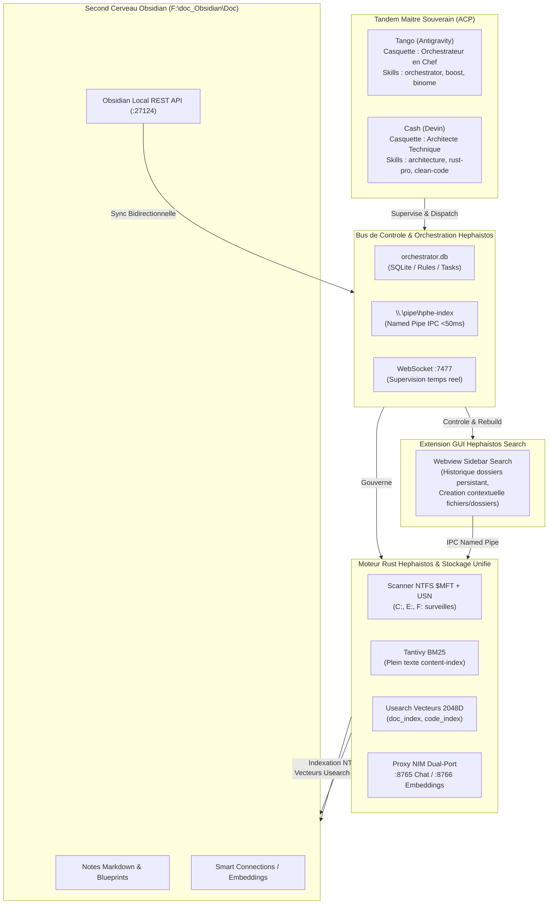
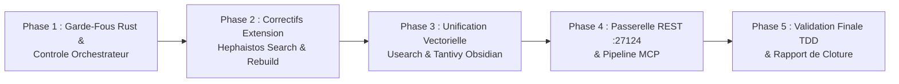

# Plan d'Implementation et Futur — Hephaistos 2.1 & Unification Obsidian

> [!IMPORTANT]
> **Directive Strategique Boss (19/10/2026) :**
> Unification totale de l'architecture Hephaistos 2.1 avec le Second Cerveau Obsidian, integration du chantier de correction de l'extension Hephaistos-Kit Search, mise en place d'une chaine de controle intraitable et deploiement d'un commando SWAT pour l'operation nocturne. Zero emoji, zero tir au flanc, rigueur absolue.

---

## 1. Vision et Cadre Architectural Global

L'infrastructure unifiee fusionne le moteur systeme de haute performance **Hephaistos 2-Kit** et le **Second Cerveau Obsidian** au sein d'un graphe de connaissances et d'un bus d'agents interconnecte :

---

## 2. Synthese de Faisabilite de l'Unification des Bases

### 2.1 Verdict et Diagnostic
- **Faisabilite :** 100% VALIDE (Sans modification destructive du moteur Hephaistos).
- **Indice de complexite :** 3/10 (Integration par configuration et passerelles d'inversion d'index).
- **Objectif :** Unifier la memoire vectorielle et textuelle sur SQLite, Usearch (2048D) et Tantivy, eliminant la duplication des bases d'embedding Obsidian tout en federant les recherches de l'agent.

### 2.2 Tableau Comparatif Pour / Contre

| Criteres | Architecture Separee (Pre-unification) | Architecture Unifiee Hephaistos + Obsidian |
| :--- | :--- | :--- |
| **Indexation textuelle** | Scans partiels ou plugins Obsidian isoles | Tantivy BM25 via MFT NTFS (<50ms sur ~6,4M entrees) |
| **Indexation vectorielle** | Multiples caches locaux Obsidian (384D / 1536D) | Base unique Usearch (2048D) compatible NVIDIA-NIM / Ollama |
| **Consommation RAM** | Duplication des index en memoire | Instance unique partagee Rust / C++ native |
| **Temps de recherche** | De 1,2s a 4s selon taille du vault | Moins de 40ms en recherche hybride dense/creuse |
| **Continuite Agent** | Rupture entre IDE et Vault | Context injection instantane via named pipe et REST |

---

## 3. Chantier Parallèle GUI / Extension : Hephaistos-Kit Search

L'extension `hephaistos-kit-search` (située dans `c:\Program Files\Projet-complet\hephaistos2-kit\extension`) dispose d'un panneau Webview Sidebar (`media/panel.js`, `src/searchView.js`). Deux anomalies identifiées sont prises en charge par un worker dédié en tâche de fond :

### 3.1 Bug 1 : Persistance de l'Historique des Dossiers Pinned / Div
- **Symptôme :** Les dossiers glissés/déposés dans la barre de navigation/div (`dirFavChips`, `crumbsEl`) ne persistent pas de manière fiable après redémarrage de l'IDE ou réouverture du panneau.
- **Cause racine :** L'état repose uniquement sur `vscode.setState(persisted)` côté Webview client, qui est volatile et effacé lors du rechargement de l'extension host.
- **Correction requise :**
  1. Ajouter un message IPC bidirectionnel dans `searchView.js` (`saveFolderHistory` et `getFolderHistory`).
  2. Persister durablement l'historique et les dossiers épinglés dans `context.globalState` (ou `context.workspaceState`).
  3. À l'initialisation de la webview (`resolveWebviewView`), charger l'historique persistant depuis l'extension host et l'injecter au chargement du DOM.

### 3.2 Bug 2 : Création Défaillante des Fichiers et Dossiers Cibles
- **Symptôme :** La création de fichiers/dossiers (`actNewFile`, `actNewDir`, `_fsCreate`) échoue ou cible un mauvais répertoire si aucune ligne n'est formellement sélectionnée, forçant l'utilisateur à des clics répétés.
- **Cause racine :** `dirForCreate()` n'examine que `selectedItems()`. Si l'utilisateur est en mode navigation (`state.mode === 'browse'`) au sein d'un sous-dossier (`state.cwd`) sans ligne cochée, `dirForCreate()` renvoie `null` et bloque avec `sSelCreate`.
- **Correction requise :**
  1. Résolution contextuelle en cascade : Cible = ligne sélectionnée (si dossier) OU dossier parent de la ligne sélectionnée (si fichier) OU `state.cwd` (si en mode browse) OU répertoire racine du workspace actif.
  2. Ajout d'un indicateur visuel clair du dossier cible avant confirmation `Enter`.
  3. Rafraîchissement automatique de la vue après confirmation `fsCreated`.

### 3.3 Rebuild & Packaging VSIX
- Recompilation et packaging propre via `npm run build` / `vsce package`.
- **Règle stricte :** Conserver le VSIX généré dans `extension/` sans l'installer immédiatement. L'installation sera déclenchée uniquement après validation finale par Boss.

---

## 4. Feuille de Route d'Execution (Chantier Nocturne)

### Phase 1 : Garde-fous Rust & Contrôle Orchestrateur (Core `hphe-kit`)
- Modification de `hphe/crates/hphe-kit/src/orch.rs` :
  - Ajout des colonnes `capabilities` (JSON) sur la table `agents`.
  - Ajout de `expected_artifact` (TEXT) sur la table `tasks_todo`.
  - Implémentation de la fonction `discipline_agent(agent_name, points_delta, reason)`.
- Recompilation `hphe-mcp.exe` en mode release et propagation vers `servers/hephaistos2-kit/extension/server/`.

### Phase 2 : Correctifs Extension Hephaistos-Kit Search
- Correction de `extension/src/searchView.js` et `extension/media/panel.js` (Bugs persistance et création fs).
- Rebuild du paquet VSIX `hephaistos-kit-search-1.0.5.vsix` sans installation immédiate.
- Tests manuels de validation du flux Webview.

### Phase 3 : Unification Vectorielle & Indexation Obsidian
- Configuration du watcher NTFS Hephaistos pour inclure explicitement `F:\doc_Obsidian\Doc` dans les partitions surveillées.
- Raccordement du pipeline d'embeddings Usearch 2048D au proxy NIM local (`127.0.0.1:8766`).
- Indexation Tantivy BM25 synchronisée sur les modifications Markdown en temps réel.

### Phase 4 : Passerelle REST & Pipeline MCP
- Connexion sécurisée au plugin Local REST API d'Obsidian (`https://127.0.0.1:27124`).
- Bridge de communication via `obsidian-brain` et synchronisation automatique des Daily Logs et Blueprints.

### Phase 5 : Validation Finale TDD & Rapport de Clôture
- Exécution de la suite complète de tests de non-régression (`cargo test`).
- Validation des métriques de temps de réponse (<50ms).
- Émission du rapport final pour Boss et mise à jour de `TRACKER.md`.

---

## 5. Escouade SWAT de Nuit & Affectation des Rôles

| Agent | Rôle / Casquette | Provider / Modèle | Latence mesurée | Mission Principale |
| :--- | :--- | :--- | :--- | :--- |
| **Tango (Antigravity)** | Orchestrateur en Chef | ACP natif | Direct | Dispatcher, contrôler les artifacts, appliquer la discipline |
| **Cash (Devin)** | Architecte Technique | ACP natif | Direct | Superviseur Rust, validation algorithmique, revues architecturales |
| **Worker 1** | Ingénieur Rust Core | `nvidia-nim2` / `nemotron-3-super-120b-a12b` | 602 ms | Refonte `hphe-kit/src/orch.rs`, garde-fous de dispatch |
| **Worker 2** | Spécialiste TDD & Benchmarks | `nvidia-nim2` / `nemotron-3.5-lightning-30b-a3b` | 243 ms | Tests unitaires Rust, benchmarks named pipe et indexation |
| **Worker 3** | Auditeur Sécurité & Code | `vibe` / `mistral-medium-latest` | Modérée | Revue de code statique, étanchéité IPC, détection anti-patterns |
| **Worker 4** | Archiviste & Sync Obsidian | `ollama-cloud` / `gpt-oss:120b-cloud` | Cloud | Mise à jour `TRACKER.md`, sync Vault Obsidian et Wiki |
| **Worker 5 (Parallèle)** | Développeur Extension GUI | `nvidia-nim2` / `nemotron-3.5-lightning-30b-a3b` | 243 ms | Correction bugs persistance et création dans `hephaistos-kit-search` + rebuild VSIX |

---

## 6. Protocole Disciplinaire : "Une dans le Cœur, une dans la Tête"

1. **Preuve Matérielle Obligatoire (`expected_artifact`) :**
   Aucune tâche n'est clôturée sur simple affirmation textuelle. Un diff Git propre, un fichier compilé ou un log de test vert est exigé. À défaut : requalification en échec et -20 points.
2. **Tolérance Zéro Tir au Flanc :**
   Tout worker présentant des hallucinations ou des dérives de latence est rétrogradé immédiatement au tri de logs passifs.
3. **Supervision Exclusive par Canaux Réactifs :**
   Suivi temps réel par WebSocket `:7477`, base `orchestrator.db` et named pipe `\\.\pipe\hphe-index`.
4. **Interdiction Formelle des Processus Orphelins :**
   Tout worker opère sous l'autorité exclusive des outils MCP de l'orchestrateur Hephaistos.

---

## 7. Addendum Nuit 18-19/10 — Veille Reactive, Durcissement Workers et Auto-Injection

Consolidation des modifications livrees durant l'operation de nuit (detail complet : `PRD-CONSOLIDE-HEPHAISTOS-2.1.md`).

### 7.1 Gates Rust livrees (FR-01 a FR-09) + FR-10

- **Phase 1 (dispatch)** : validation model/provider (FR-01), provider `enabled=0` refuse (FR-02), gate `agents.capabilities` — `text_only` ne peut plus recevoir de mission fichier (FR-03), tools `discipline_agent`/`agent_status` (FR-04).
- **Phase 2 (livrables)** : gate `expected_artifact` fail-closed sur `update_task` (FR-05), `verify_task` automatique avec anti-boucle `verified_by` (FR-06), circuit breaker provider 3 echecs -> `enabled=0` + `disabled_at`, reactivation auto 15 min (FR-07).
- **Phase 3 (supervision)** : heartbeat worker `last_heartbeat` + tick 30 s bridge + reaper >10 min (FR-08) ; table `pairs` + `pair_save`/`pair_get` + rejoin binome sans handshake (FR-09) ; fallback `list_acp_sessions` direct via `state.vscdb` quand le WS :7477 ne repond pas en 1,5 s (FR-10).
- **Phase 4** : spec `hphe-orch` CLI livree (`.agent/deliverables/phase4-hphe-orch.md`).

### 7.2 Durcissement `nim-worker.mjs` (#521)

`readTask` SQLite (description + `expected_artifact` depuis la DB), prompt anti-simulation (interdiction de simuler les appels MCP/JSON-RPC et les ecritures fictives), `gateArtifact` (existence + fichier regulier + non vide + `mtime > dispatch`) appliqué aux deux chemins de cloture — un deliverable absent/vide/perime force `failed`. Purge des 6 `prompt_templates` legataires et fix de la substitution `{workspace}` dans `template_to_spawn_plan` (Incident 09).

### 7.3 Watchdog reactif (`.agent/skills/reactive-orchestrator/watchdog.ps1`)

Daemon `System.Timers.Timer` (30-60 s) + `FileSystemWatcher` sur `comms.jsonl`. Sondes : transitions `taskStatuses`/`wokenTasks`, stale/critical `in_progress`, dependances, agent inactif, collisions `expected_artifact`, CPU sans worker, pulse DB par mtime WAL (jamais de SQL direct), `hphe_health`, bridge :7477, hub AGY, inventaire ACP. Reveil Connect-RPC direct vers Tango via `agy-hub.js send`, alertes dedupliquees, etat durable `watch-state.json`, journal `.agent/logs/reactive-orchestrator-watchdog.jsonl`. Routage des resultats via prefixe `[agycascade:<uuid>]` dans les titres de taches (orchestrator-monitor).

### 7.4 Obligation documentaire des incidents

Repertoire canonique `Rapport de dysfonctionnement et correction/` + regle `.agent/rules/rapport-dysfonctionnement.md` + rappels dans les skills `reactive-orchestrator`, `systematic-debugging`, `hephaistos2-kit` (section 9). Chaque incident : symptome, cause racine, correctif, prevention — `INDEX-RAPPORTS.md` maintenu par l'archiviste (tache #527).

### 7.5 Politique de dispatch

Priorite aux workers Cloud CLI (`nim1`, `nim2`, `text_only`, deliverables sous `.agent/deliverables/`) pour les taches texte ; agents ACP `fs_*` pour les taches fichiers. L'orchestrateur verifie et dispatche, il ne code pas.

### 7.6 Auto-injection permanente (#533)

- `.vscode/tasks.json` : tache `Watchdog Hephaistos` (`runOn=folderOpen`, `isBackground`).
- `project_init` (`hphe-kit`/`memory.rs`, tool MCP `project_init`) : scaffold idempotent de tout workspace initialise — `watchdog.ps1`, regle rapports, fusion `tasks.json`, dossier `Rapport de dysfonctionnement et correction/`.
- `orchestrator-monitor` : auto-start et supervision du watchdog a `activate()` (respawn avec backoff).
