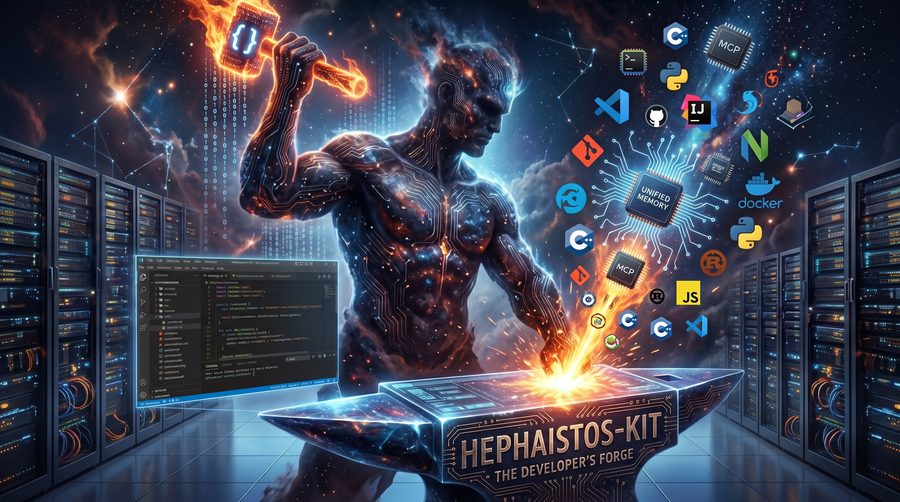

<p align="center">
  
</p>

# Hephaistos2-Kit

**Visual multi-agent orchestration IDE for VS Code forks, backed by a unified
Rust search engine.**

Hephaistos2-Kit lets a user compose an agent team on a React Flow canvas —
agents, roles, providers, models, skills, MCP tools, external services — wire
execution dependencies between them, persist the workflow, and run it under a
head agent connected through ACP.


> **Public beta.** The kit is functional on the development machine;
> reproducible multi-machine installation is in progress.

---

## Features

| Area | Description |
|---|---|
| Visual orchestration | React Flow canvas with minimap: drag-and-drop agent, skill, role, provider and service cards; execution and tool edges |
| SWAT workflows | Persisted schemas, live workflow switching, acyclic execution DAG, node-level roles and missions |
| Bleubite workers | Tool-enabled `chat-*` workers (filesystem read/write/list confined to the workspace) on free or custom providers |
| Real ACP binding | Detection of open IDE agent sessions (Devin, Antigravity), card-to-session binding, prompt injection |
| Filesystem search | ~6.4M-entry NTFS `$MFT` index with live USN journal, sub-50 ms queries, BM25 + semantic + hybrid search |
| Unified MCP server | One stdio server (`hphe-mcp`, 58 tools): search, content, vectors, memory, task orchestration, beacon |
| Unified memory | Knowledge graph + 2048D vector store + SQLite via `memory_*` tools, workspace/global separation |
| Task orchestrator | `create_task`/`dispatch_task`/`update_task`, append-only `comms.jsonl` bus, IDE wake-up |
| Skill-mux | MCP stdio server exposing a central machine skill registry, rebuilt on the fly |
| Beacon | Agent activity journal ingestion with built-in secret redaction into HPHE memory |
| Multi-IDE | Devin Desktop, Antigravity, Cursor — shared `.agent` layer propagated by `sync-agent-layer.ps1` |

## The workspace — `hephaistos-chats`

The `hephaistos-chats` extension provides the visual workspace:

- **Canvas** — cards are nodes, edges are execution routing; orchestration is
  defined manually by the user, not improvised by a model.
- **Palettes** — agents, skills, roles, providers, services, preconfigured cards.
- **Two edge types**:
  - *execution* (solid): DAG dependency — a step starts when its parents return;
  - *tool* (dotted, dedicated ⛁ port): the service is pre-fetched once and its
    result injected into the target worker's prompt (per-agent tool, or whole
    team when wired to the entry node).
- **Inspector** — role, mission, provider/model, per-card-type parameters.
- **Persistence** — schema bank + active roster, preserved node positions,
  hot workflow switching.
- **ACP binding** — `workspace-roster` lists live sessions and binds a card to a
  real session; `acp-inject` delivers the mission.
- **Commands** — `newChat`, `openChat`, `openWorkspace`, `openComfyUI`.

### Service cards

| Card | Appearance | Behavior |
|---|---|---|
| `svc/n8n/<workflowId>` | Red `#EA4B71`, n8n logo | Live n8n workflow dropdown in the inspector; invoked through `POST /n8n/workflows/:id/invoke` — the webhook secret stays on the bridge, never in the extension |
| `svc/comfyui/<id>` | Orange `#F5A623`, ComfyUI logo | Service card scaffold; unwired `svc/*` transports are refused explicitly by the runner |

## External integrations

- **n8n** (:5678) — packaged workflows (Telegram bot, Obsidian hub, image
  generation, `/tg/poll` polling); read-only DB access lists workflows
  without depending on the n8n API.
- **ComfyUI** — local Desktop backend and a remote GPU path on Kaggle
  (`kaggle_push`, named Cloudflare tunnel, automatic GPU shutdown after
  10 min idle, `kaggle-ctl.ps1`).
- **Obsidian** — explicit, opt-in integration: `obsidian-cli.mjs` (vault
  bounded by `OBSIDIAN_VAULT_PATH` / `local-paths.json`),
  `obsidian-mcp-proxy.mjs`, the `antigravity-obsidian` skill, and two
  packaged n8n workflows. Inactive when no vault is configured.
- **LLM providers** — NVIDIA NIM, OpenRouter, OmniRoute, devin-cli,
  antigravity-acp, ollama-cloud; selected per card in the inspector.

## Architecture

```
IDE (Devin / Antigravity / Cursor)
   │  hephaistos-chats (React Flow)          hephaistos-kit-search
   │        │                                     │
   ├──HTTP──┼──► bridge-api :7478 ──┐   ──stdio──► hphe-mcp.exe (58 tools)
   ├──WS────┼──► bus        :7477  │            │
   │        │    ├─ /swat/* runner │            ├─► pipe \.\pipe\hphe-index
   │        │    ├─ /n8n/* svc     │            │     ► hphe-indexd (SYSTEM)
   │        │    ├─ /tools/call    │            │     $MFT ~6.4M + USN + mmap
   │        │    └─ /diagnostics   │            ├─► Tantivy (content index)
   │        └─► MCP gateway :8767  │            ├─► usearch (2048D vectors)
   │                               │            └─► orchestrator.db + memory KG
   └─ACP──► IDE sessions (devin/agy/chat-*) ◄── acp-inject + roster
```

- **`hphe-indexd`** — SYSTEM scheduled task: `$MFT` scan, live USN journal,
  named-pipe index.
- **`hphe-mcp`** — single stdio MCP server absorbing the former separate MCPs.
- **`hphe-rest`** (:8792) — REST facade of the same tools plus the ingestion
  loop (single-writer serialization for Tantivy).
- **`agent-bridge`** (:7478 HTTP + :7477 WS) — SWAT runner (DAG + tool edges +
  `svc/n8n` pre-fetch), live roster, ACP injection, diagnostics.

## Agent layer

`.agent/` is the declarative layer propagated to workspaces:

```
.agent/
├── agents/        # agent definitions (frontmatter triggers -> routing)
├── skills/        # packaged skills
├── rules/         # governance rules
├── workflows/     # reference SWAT schemas
├── agent-bridge/  # HTTP/WS bridge, SWAT runner, roster, acp-inject
├── flux/          # active-schema pipeline (review/security/arbitration/commit)
├── scripts/       # install, sync, health, watchers
└── state/, chats/, queue/  # runtime (gitignored)
```

Secrets are never committed: `.env`, `*.token`, `local-paths.json` are
gitignored and machine paths are externalized through `local-paths.js`.

## Installation

```powershell
git clone --recurse-submodules https://github.com/art-qalam-fr/hephaistos2-kit.git
cd hephaistos2-kit
pwsh -ExecutionPolicy Bypass -File install.ps1
```

Requirements: Windows 10/11 (NTFS), PowerShell 7, Rust stable, Node ≥ 20, an
ACP-capable VS Code fork. Admin rights are only needed for the `hphe-indexd`
scheduled task (`-Elevated`). Details: [INSTALL.md](INSTALL.md) and the
declarative manifest [kit.toml](kit.toml).

## Configuration

| Element | Mechanism |
|---|---|
| API keys | Environment variables / prompt — never hardcoded; template [.env.example](.env.example) |
| Machine paths | Gitignored `local-paths.json` read by `local-paths.js` |
| MCP access profiles | [.mcp-access](.mcp-access) — `allow`/`read`/`deny` rules with `<INSTALL_ROOT>` tokens |
| Bridge auth | Generated, gitignored `.agent/ws-bridge.token` / `HPHE_REST_TOKEN` |

## Extensions

| Extension | Source | Role |
|---|---|---|
| `hephaistos-chats` | `extensions/hephaistos-chats` | Visual workspace — canvas, cards, SWAT, ACP roster |
| `hephaistos-kit-search` | `extensions/search-ext` (submodule) | NTFS search inside the IDE, ships the MCP server |
| `orchestrator-monitor` | `extensions/orchestrator-monitor` (submodule) | Agents/tasks/providers panel, wake-up bridge, multi-workspace bus |
| `postdev` | packaged VSIX (`extensions/vsix/`) | Post-dev utilities; source repository pending publication |

Technical sheets: [docs/VSIX.md](docs/VSIX.md).

## Stability notes

- ACP single-flight mutex per `providerId/sessionId` (120 s TTL) prevents
  duplicate session cascades.
- CLI worker throttle
 throttle (2 concurrent) with `BELOW_NORMAL` process priority.
- `tools/reap-and-reconcile.ps1` reaps ghost tasks and reconciles orphans.

## Known limitations

- Machine-specific defaults remain to be parameterized per install.
- Feedback loops are rejected at schema validation (the execution DAG is
  acyclic); cyclic review flows are on the roadmap.
- `postdev` ships as a packaged VSIX pending its source publication.

## Documentation

| Doc | Content |
|---|---|
| [INSTALL.md](INSTALL.md) | Step-by-step installation |
| [docs/MCP-TOOLS.md](docs/MCP-TOOLS.md) | MCP tools reference |
| [docs/VSIX.md](docs/VSIX.md) | Extension build/version/install sheets |
| [.agent/ARCHITECTURE.md](.agent/ARCHITECTURE.md) | Reference architecture |
| [docs/wiki/](docs/wiki/) | Project wiki |
| [AGENTS.md](AGENTS.md) | Agent protocol |

## License

Proprietary beta license — evaluation use only. See [LICENSE](LICENSE).
