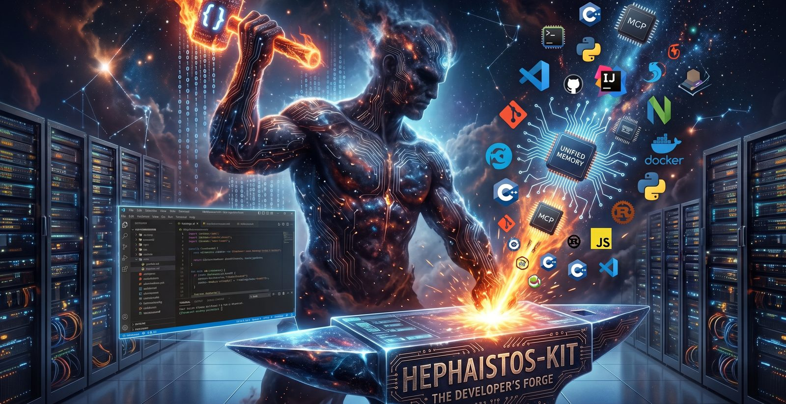

# Hephaistos Orchestrator Monitor

*English version below.*

**Tableau de bord temps réel pour l'orchestrateur multi-agents du Hephaistos-Kit** — tâches, agents, modèles et fournisseurs (providers), supervisés et pilotés directement depuis votre IDE.

Cette extension fait partie intégrante de l'écosystème **[Hephaistos-Kit](https://github.com/art-qalam-fr/Hephaistos-Kit)** (*The Developer's Forge*), la forge open source d'infrastructure agentique : serveurs MCP, CLIs de délégation, règles et procédures versionnées, injectables en une commande.

---

## 🇫🇷 Fonctionnalités Principales

Le Monitor se connecte à la base de l'orchestrateur (orchestrator.db) via un pont WebSocket local très léger (lecture seule, rafraîchissement temps réel) et affiche l'activité en direct de vos agents :

- 📊 **Vue d'ensemble (KPIs)** : Compteurs en temps réel des tâches en cours, en attente, terminées, échouées et des agents actifs.
- 📋 **Gestion des Tâches Avancée** : Groupes de tâches repliables, colonnes **redimensionnables et déplaçables** (drag & drop persisté). Visualisation du prompt complet envoyé à l'agent et du résultat retourné.
- 🔗 **Chaîne de Fournisseurs (Providers) Interactive** : Chaque fournisseur (NVIDIA NIM, Ollama, Antigravity, KiloCode, etc.) est représenté par un bouton on/off et peut être **glissé-déposé (drag & drop)**. Modifier cet ordre altère directement la priorité de l'orchestrateur en direct !
- 🤖 **Cartes Agents** : Visualisez les compétences (skills), les modèles associés et l'état actif de chaque agent de la forge.
- ⚡ **Injection Directe** : Envoyez une tâche, un résultat ou un groupe complet directement dans votre fenêtre de chat Devin/Antigravity en un seul clic.
- 🌍 **Multilingue Intégré** : Support natif du Français, Anglais, Allemand et Espagnol (suit la langue de votre IDE).

## 🚀 Installation & Utilisation

1. Récupérez le fichier .vsix ou installez l'extension depuis le store.
2. Developer: Reload Window — l'icône **Hephaistos (Enclume)** apparaît dans la barre latérale.
3. Le pont WebSocket démarre automatiquement. Si l'orchestrateur est inactif, le moniteur passera en mode hors-ligne en attendant son réveil.

**Commandes disponibles via Ctrl+Shift+P :**
- Hephaistos : Ouvrir le panneau Orchestrateur (Plein écran)
- Hephaistos : Démarrer / Redémarrer le bridge
- Hephaistos : Purger les tâches terminées/échouées

---

## ☕ Soutenir le projet

Le Hephaistos-Kit est et restera **gratuit et open source (MIT)**. Forgé initialement pour un besoin personnel, il est aujourd'hui offert à la communauté. Si cet outil vous fait gagner de précieuses heures, vous pouvez m'offrir un café :

  
   Scannez ou <a href="https://www.paypal.com/qrcodes/managed/c2348e9b-fb7a-4aef-85a8-628b0a9ea8b7">cliquez ici pour un don PayPal</a>

*Aucune obligation — le soutien finance simplement les nuits blanches passées à forger l'architecture !*

---
---

## 🇬🇧 Main Features (English)

**Real-time dashboard for the Hephaistos-Kit multi-agent orchestrator** — supervise tasks, agents, models, and providers directly from your IDE.

This extension is a core component of the **[Hephaistos-Kit](https://github.com/art-qalam-fr/Hephaistos-Kit)** (*The Developer's Forge*), an open-source agentic infrastructure framework.

The Monitor connects to the orchestrator database (orchestrator.db) via a lightweight local WebSocket bridge to display live agent activity:

- 📊 **KPI Overview**: Real-time counters for running, pending, completed, failed tasks, and active agents.
- 📋 **Advanced Task Management**: Collapsible task groups, **resizable and draggable** columns. Expand rows to view the full prompt sent to the agent and the exact execution result.
- 🔗 **Interactive Provider Chain**: Each provider (NVIDIA NIM, Ollama, Antigravity, KiloCode, etc.) acts as an on/off toggle and can be **dragged and dropped**. Changing this order immediately alters the orchestrator's routing priority!
- 🤖 **Agent Cards**: View the skills, associated models, and active status of each forge agent.
- ⚡ **Direct Chat Injection**: Send a task, its result, or a whole task group directly into your Devin/Antigravity chat window with one click.
- 🌍 **Multilingual**: Native support for English, French, German, and Spanish.

## 🚀 Installation & Usage

1. Grab the .vsix file or install from the marketplace.
2. Developer: Reload Window — the **Hephaistos (Anvil)** icon appears in the Activity Bar.
3. The WebSocket bridge starts automatically. If the orchestrator is offline, the monitor will wait patiently.

**Available Commands (Ctrl+Shift+P):**
- Hephaistos: Open Orchestrator Panel (Full screen)
- Hephaistos: Start / Restart Bridge
- Hephaistos: Purge completed/failed tasks

---

## ☕ Support the Forge

Hephaistos-Kit is and will remain **free and open-source (MIT)**. If this tool saves you hours of debugging and agent management, consider buying me a coffee:

  
   Scan or <a href="https://www.paypal.com/qrcodes/managed/c2348e9b-fb7a-4aef-85a8-628b0a9ea8b7">click here for a PayPal donation</a>

*No obligations — your support fuels the late-night forging sessions!*

---

**Links & References:**
- **Public Repository**: [art-qalam-fr/Hephaistos-Kit](https://github.com/art-qalam-fr/Hephaistos-Kit)
- **License**: MIT
